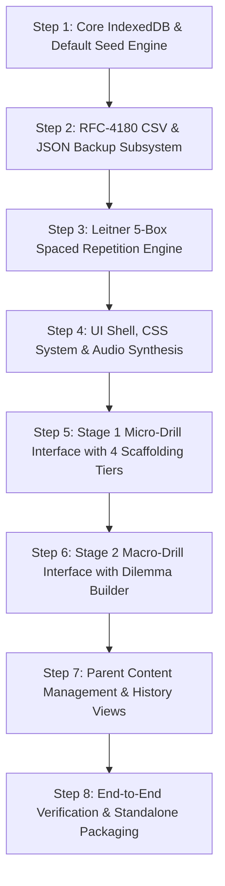

# Technical & Pedagogical Blueprint: CompoHelper English (80/20 Active-Recall Web App)

**Document Version:** 2.1.0-draft  
**Target Learner:** Singapore Primary-School Student entering Primary 5 (P5) in January 2027 (Transitioning to Upper Primary)  
**Primary Assessment Target:** Singapore MOE Primary English Syllabus (Continuous Writing / Upper Primary Picture & Theme Narrative)  
**Practice Cadence:** 15-Minute Daily Routine (10 min Micro-Drills + 5 min Macro-Drill)  
**Architecture:** 100% Local-First Single-File Web App (`index.html` + `IndexedDB` + Web Speech API)  
**Operational Footprint:** Zero SaaS, zero accounts, zero cloud dependencies, offline-ready on Windows PC & Android.

---

## 1. Product Overview and Learning Objectives

### 1.1 The Upper Primary Developmental Transition (P5 Horizon)
The student has completed P3 and P4 English and understands foundational writing strategies (5W1H, FAST, Five Senses, Show Not Tell, Transition-Action-Detail). 

**Critical Distinction:**
These techniques are **NOT** new material to be introduced from scratch. The student does not need remedial explanations of what "FAST" stands for. 

Instead, the developmental hurdle in Upper Primary (P5–P6) is the shift from **mechanically reciting strategies** to **applying them independently, selectively, and effectively** under realistic writing conditions. In P3–P4, ticking off FAST elements or 5W1H answers was sufficient. In P5, composition assessment demands:
- Multiple character perspectives and empathy.
- Believable character motivations and genuine internal conflicts.
- Cause-and-effect plot progression ($A \to B \to C$).
- Building tension and anticipation (narrative pacing).
- Meaningful turning points that test character values.
- Selective, purposeful language and dialogue (not decorative vocabulary).
- Independent evaluation, revision, and refinement of one's own ideas.

The application must prepare the student progressively for upper-primary narrative expectations without making exercises artificially obscure or turning daily practice into a high-anxiety PSLE drill. Difficulty must increase through **reasoning, emotional depth, psychological stakes, and independent application**, not archaic idioms.

### 1.2 Primary Learning Priorities
1. **Meaningful Idea Generation & Selection:** Choosing plot events that directly address the core conflict rather than generic filler.
2. **Coherent & Convincing Plot Development:** Ensuring events flow logically with tight cause-and-effect connections.
3. **Character Motivation & Internal Conflict:** Grounding actions in competing desires (e.g. fear of punishment vs. loyalty; self-preservation vs. doing the right thing).
4. **Appropriate Scene Elaboration:** Knowing *which* moments deserve expansion (the pivotal dilemma) and which should be compressed (mundane transitions).
5. **Theme Demonstration via Costly Action:** Proving the theme through character choices and consequences, never through tacked-on moral platitudes.
6. **Narrative Pacing & Tension:** Decelerating time during high-stakes turning points to build anticipation.
7. **Purposeful Language:** Choosing precise verbs and authentic dialogue over flowery, memorised clichés.
8. **Independent Review & Revision:** Developing the critical eye to spot flat, "telling" sentences or moral-puppet characters and rewrite them for impact.

### 1.3 Four-Level Progressive Scaffolding Model
To foster true independence and skill transfer rather than rote memorisation, micro-drill exercises are organised into four progressive cognitive tiers:

```
[ Level 1: Recall & Identify ]   --> Identify active/missing strategy levers in a given beat
              |
              v
[ Level 2: Guided Application ]  --> Apply strategy to a scenario with progressive 3-tier hints
              |
              v
[ Level 3: Independent Application ] --> Develop scene/beat unprompted (hints completely faded)
              |
              v
[ Level 4: Evaluation & Critique ]   --> "Draft Doctor": Diagnose flawed drafts & rewrite for impact
```

1. **Level 1 (Recall):** Identify which writing lever (e.g., FAST: Thought, 5W1H: Why) is missing or needed to make a flat sentence convincing.
2. **Level 2 (Guided Application):** Apply the technique to an Upper Primary scenario using optional, progressive hints.
3. **Level 3 (Independent Application):** Formulate the scene development completely unprompted; hints are collapsed or faded.
4. **Level 4 (Evaluation & Critique):** Read a flawed draft (e.g., an "Instant Saint" reaction or an "Idiom Dump"), explain why it is pedagogically weak, and formulate an improved revision.

---

## 2. Detailed Pedagogical Design

```
+---------------------------------------------------------------------------------------------------+
|                           P5 TRANSITIONAL 15-MINUTE DAILY PRACTICE ROUTINE                         |
+---------------------------------------------------------------------------------------------------+
|  STAGE 1: MICRO-DRILLS (10 Mins)                     |  STAGE 2: MACRO-DRILL (5 Mins)              |
|  Rotates across 4 Scaffolding Levels:                 |  Full Narrative Arc & Scene Crucible        |
|  - Character Motivation & Internal Dilemmas          |  - 4-Part Plot Skeleton Canvas             |
|  - Building Tension & Pacing Deceleration            |  - Escalating Build-up & Causal Chains     |
|  - Multiple Perspectives & Empathy                   |  - Pivotal Climax Dilemma Selection        |
|  - Selective FAST & Plot-Relevant Sensory Cues       |  - 3-Minute Timed Pressure Elaboration     |
|  - Level 4 "Draft Doctor" Revision Exercises         |  - Theme Verification (Costly Choice)      |
|  - Anti-Pattern Warnings on Card Flip                |  - Optional Slotting of Mastered Phrases   |
+---------------------------------------------------------------------------------------------------+
```

### 2.1 The Four-Part Plot Skeleton (P5 Upper Primary Arc)
Upper primary compositions require narrative momentum and psychological realism across four slots:
1. **Opening (Hook, Context & Baseline Atmosphere):** Establishes normal conditions, character relationships, and an underlying baseline emotional state before the disruption occurs.
2. **Build-up (Inciting Incident, Escalation & Causal Chains):** The problem arises. Crucially, events do not happen randomly; each event is caused by the previous reaction ($Event \to Emotional Reaction \to Choice \to Consequence \to New Event$). Stakes escalate.
3. **Turning Point / Climax (Crisis, Internal Dilemma & Costly Action):** The critical crossroads. The character faces a genuine dilemma where doing the right thing involves sacrifice, risk, or loss. The choice reveals true character.
4. **Resolution (Believable Fallout & Organic Reflection):** Aftermath and settlement. The character experiences an internal shift based on what occurred, avoiding pre-packaged moral aphorisms (*"Honesty is the best policy"*).

### 2.2 P5–P6 High-Value Narrative Levers

#### A. Internal Conflict & Dilemmas (Beyond P3/P4 "Feelings")
In lower primary, feeling sad or happy was sufficient. In Upper Primary, characters must experience **competing motivations**:
- *Protagonist Dilemma:* Wants to protect a friend's secret VS. Fears becoming an accomplice to theft.
- *Cost of Choice:* Doing the right thing must carry a real cost (e.g., detention, social embarrassment, losing a competition). If doing the right thing is easy, there is no narrative drama.

#### B. Multiple Perspectives and Empathy
Stories become two-dimensional when supporting characters exist merely to be talked to. P5 writing requires understanding the other person's interiority:
- *Supporting Character Depth (The Lily Principle):* Why is Lily hesitant? Is she afraid of being blamed? Does she feel betrayed?
- *Contrasting Reactions:* When an accident happens, show how the victim feels versus how the guilty bystander reacts.

#### C. Building Tension & Narrative Deceleration (Pacing)
P3/P4 students often rush through the most important moment in two sentences (*"Suddenly, the glass broke. Then I confessed."*). Upper Primary writing requires **narrative deceleration**:
- Slowing down time at the critical moment.
- Zooming in on micro-actions: the trembling hand, the ticking clock, the deafening silence, the frozen breath.
- Heightening anticipation before an inevitable confrontation.

#### D. Selective FAST & Show Not Tell
- **Selective Application:** Reject the mechanical rule of *"one Feeling, one Action, one Speech, one Thought per paragraph"*. A tense silence often requires only an **Action + Thought**. A confrontation requires **Speech + visceral Feeling**.
- **Physical & Behavioral Evidence:** Convert abstract statements into physiological reactions (e.g., dry throat, clutching hem of shirt, avoiding eye contact).

#### E. Transition-Action-Detail (TAD) Pacing
- **Transition:** Temporal or spatial pivot (*"With five minutes left before the dismissal bell..."*).
- **Action:** The core event (*"...Marcus reached into the lost-and-found tray."*).
- **Detail:** Deepening through internal dialogue or sensory cues (*"...His fingers brushed against the metal watch, cold against his clammy skin."*).

### 2.3 Explicit Upper Primary Anti-Patterns
1. **The Instant Saint:** A protagonist who never feels tempted and immediately does the right thing without any internal struggle.
2. **The Moral Puppet:** A supporting character who exists solely to say: *"Remember what our teacher said! Stealing is wrong!"*
3. **The Weather Intro Filler:** Spending 50 words on chirping birds and golden sunbeams that have zero relevance to a classroom theft story.
4. **The Idiom Dump:** Shoving memorised idioms (*"a bolt from the blue," "as happy as a lark"*) into scenes where they sound artificial or overdramatic.
5. **The Preacher's Epilogue:** Ending with a generic cliché (*"I learnt that honesty is the best policy and I will never do it again"*) rather than a personal, character-specific realization.

---

## 3. Exact Data Schema

### 3.1 IndexedDB Architecture (`CompoHelperEnglishDB`, Version 2)

```mermaid
erDiagram
    STRATEGY_CARDS ||--o{ REVIEW_LOGS : "schedules"
    PHRASE_CARDS ||--o{ REVIEW_LOGS : "schedules"
    PROMPT_TEMPLATES ||--o{ SESSION_LOGS : "used in"

    STRATEGY_CARDS {
        string id PK "strat-001"
        string scaffolding_level "LEVEL_1_RECALL | LEVEL_2_GUIDED | LEVEL_3_INDEPENDENT | LEVEL_4_EVALUATE"
        string category "MOTIVATION_CONFLICT | TENSION_PACING | PERSPECTIVE_EMPATHY | FAST | 5W1H | SHOW_NOT_TELL | TAD | THEME_LINK | CRITIQUE_REVISION"
        string sub_category "Internal Dilemma | Pacing Deceleration | Empathy | Actions | Thoughts | Causality"
        string_array theme_tags "Honesty, Responsibility, Courage, Empathy, Peer Pressure"
        string title "Short descriptive exercise title"
        string scenario_prompt "The baseline scenario or flawed passage"
        string guiding_question "Specific challenge or critique prompt"
        string_array hints "Progressive hints (revealed 1 by 1)"
        string model_answer "Exemplary developed response / revision"
        string technique_breakdown "Pedagogical rationale explaining WHY this works"
        string anti_pattern_warning "Common trap or artificial formula to avoid"
        int srs_box "1 to 5 (Leitner)"
        float srs_interval "Interval in days"
        string due_date "ISO YYYY-MM-DD"
        string last_reviewed "ISO YYYY-MM-DD"
        int total_reviews "Total review attempts"
        int lapses "Demotion count"
    }

    PHRASE_CARDS {
        string id PK "phr-001"
        string phrase "Target phrase / sentence pattern"
        string meaning "Meaning and context of usage"
        string example_sentence "Sentence illustrating natural usage"
        string_array theme_tags "Dilemma, Tension, Relief, Guilt, Determination"
        string_array functional_tags "FAST:Thought, FAST:Action, Pacing:Slowdown, Transition"
        string_array suitable_slots "Opening, Build-up, Climax, Resolution"
        string anti_pattern "Mandatory warning: when NOT to use"
        int srs_box "1 to 5 (Leitner)"
        float srs_interval "Interval in days"
        string due_date "ISO YYYY-MM-DD"
        string last_reviewed "ISO YYYY-MM-DD"
        int total_reviews "Total review count"
        int lapses "Demotion count"
    }

    PROMPT_TEMPLATES {
        string id PK "prm-001"
        string title "Prompt title"
        string theme "Target exam theme (e.g. A Difficult Decision)"
        string prompt_type "Theme-Based | Picture-Based | Situational"
        string situation_context "Brief context description"
        string default_slot1 "Opening baseline context"
        string default_slot2 "Build-up causal escalation"
        string default_slot3 "Climax internal crisis & turning point"
        string default_slot4 "Resolution fallout & reflection"
        string pivotal_scene_prompt "Specific scene prompt for 5-min macro drill"
        string_array suggested_phrase_ids "References to PhraseCard IDs"
    }

    CONFIG {
        string key PK "settings singleton"
        string exam_date "Target exam date (YYYY-MM-DD)"
        int daily_review_limit "Max reviews per day (default: 10)"
        int daily_new_limit "Max new cards per day (default: 2)"
        float voice_rate "TTS speech rate (default: 0.9)"
        string voice_lang "Preferred TTS language (en-SG > en-GB > en-US)"
        boolean audio_enabled "Enable/disable Web Speech API"
    }

    SESSION_LOGS {
        string date PK "ISO YYYY-MM-DD"
        int stage1_reviews_completed "Count of cards reviewed"
        int stage1_new_learned "Count of new cards introduced"
        int stage1_again_count "Count of Again ratings"
        int stage1_good_count "Count of Good ratings"
        int stage1_easy_count "Count of Easy ratings"
        string stage2_prompt_id "Prompt ID used for Macro-drill"
        string stage2_slot1_text "Student opening notes"
        string stage2_slot2_text "Student build-up notes"
        string stage2_slot3_text "Student climax notes"
        string stage2_slot4_text "Student resolution notes"
        string stage2_pivotal_scene_text "Drafted scene elaboration"
        int duration_seconds "Total practice time in seconds"
        boolean completed "True if both stages finished"
    }
```



### 3.2 Master Spreadsheet CSV Specification
Three distinct CSV formats are supported:

#### A. Strategy Cards CSV (`strategies.csv`)
Headers: `id,scaffolding_level,category,sub_category,theme_tags,title,scenario_prompt,guiding_question,hints,model_answer,technique_breakdown,anti_pattern_warning`
- Standard RFC-4180 format. Semicolons (`;`) delimit arrays in `theme_tags` and `hints`.

#### B. Phrase Bank CSV (`phrases.csv`)
Headers: `id,phrase,meaning,example_sentence,theme_tags,functional_tags,suitable_slots,anti_pattern`
- Semicolons (`;`) delimit arrays in `theme_tags`, `functional_tags`, and `suitable_slots`.

#### C. Macro Prompts CSV (`prompts.csv`)
Headers: `id,title,theme,prompt_type,situation_context,default_slot1,default_slot2,default_slot3,default_slot4,pivotal_scene_prompt,suggested_phrase_ids`

### 3.3 Concrete Upper Primary Sample Records

#### 1. Level 4 Evaluation & Critique ("Draft Doctor") Record (`StrategyCard`)
```json
{
  "id": "strat-eval-001",
  "scaffolding_level": "LEVEL_4_EVALUATE",
  "category": "CRITIQUE_REVISION",
  "sub_category": "Internal Dilemma vs. Instant Saint",
  "theme_tags": ["Doing the Right Thing", "Honesty"],
  "title": "Fixing the 'Instant Saint' Flaw in a Confession Scene",
  "scenario_prompt": "DRAFT TO CRITIQUE:\n'When Mrs Tan asked who broke the projector remote, Ryan felt very bad. He immediately stood up and said, \"Mrs Tan, it was an accident, I broke it.\" Mrs Tan praised him for being an honest boy who always does the right thing.'",
  "guiding_question": "Why is this draft unconvincing for Upper Primary? Identify the missing internal conflict, then write a revision showing what Ryan feared losing before he made the difficult choice.",
  "hints": [
    "Critique: Ryan acts like an 'instant saint'—there is zero hesitation or fear of punishment.",
    "Revision Step 1: Show his internal panic (what happens if he confesses? what happens if he stays quiet?).",
    "Revision Step 2: Show the physical delay before his courage takes over."
  ],
  "model_answer": "CRITIQUE:\nThe character shows no realistic fear or dilemma. Confession feels effortless, and the teacher's reaction is a generic moral sermon.\n\nPURPOSEFUL REVISION:\nMrs Tan’s sharp gaze swept across the silent classroom. A cold sweat prickled Ryan’s neck. If he spoke up, he would face detention and have to pay for the remote with his allowance. But if he kept quiet, the whole class would stay back after school. His heart hammered in his ears as his fingers twisted the hem of his uniform. Taking a ragged breath before fear could pin him to his chair, Ryan pushed himself up.",
  "technique_breakdown": "Upper Primary realism requires showing the cost of the decision. Ryan calculates the consequence (detention, allowance loss) and battles his fear before acting.",
  "anti_pattern_warning": "Do not turn teachers into instant praise-machines. Real consequences exist, and honest choices are hard.",
  "srs_box": 1,
  "srs_interval": 1.0,
  "due_date": "2026-11-15",
  "last_reviewed": null,
  "total_reviews": 0,
  "lapses": 0
}
```

#### 2. Level 2 Guided Application: Multiple Perspectives / The Lily Principle (`StrategyCard`)
```json
{
  "id": "strat-persp-001",
  "scaffolding_level": "LEVEL_2_GUIDED",
  "category": "PERSPECTIVE_EMPATHY",
  "sub_category": "Supporting Character Integrity",
  "theme_tags": ["Peer Pressure", "Doing the Right Thing"],
  "title": "Supporting Character: Giving Lily Her Own Stakes",
  "scenario_prompt": "Lily sees her best friend Chloe about to cheat during a weighted assessment by looking at notes hidden in her pencil case.",
  "guiding_question": "Do not make Lily a moral robot who preaches about school rules. Develop Lily's perspective: show her conflicting loyalties between protecting Chloe and stopping an unfair act.",
  "hints": [
    "What does Lily fear Chloe will think of her if she interferes?",
    "How does Lily physically communicate her warning without publicly exposing Chloe?",
    "Show Lily's internal hesitation before she taps Chloe's desk."
  ],
  "model_answer": "Lily froze, her pencil hovering above her test paper. Shouting for the invigilator would mean Chloe's immediate zero and the end of their five-year friendship. Yet sitting by while Chloe cheated felt like a punch to the gut. Swallowing the lump in her throat, Lily dropped her eraser so it bounced against Chloe’s shoe, locking eyes with her friend and shaking her head in frantic, silent pleading.",
  "technique_breakdown": "Lily possesses agency: she protects the friendship while actively intervening through a discreet physical action (dropping the eraser) rather than preaching.",
  "anti_pattern_warning": "Never have a supporting character say: 'Chloe, cheating is against the rules!' Children handle peer dilemmas with secrecy and emotional friction.",
  "srs_box": 1,
  "srs_interval": 1.0,
  "due_date": "2026-11-15",
  "last_reviewed": null,
  "total_reviews": 0,
  "lapses": 0
}
```

#### 3. Level 3 Independent Application: Pacing Deceleration at the Turning Point (`StrategyCard`)
```json
{
  "id": "strat-pacing-001",
  "scaffolding_level": "LEVEL_3_INDEPENDENT",
  "category": "TENSION_PACING",
  "sub_category": "Narrative Deceleration",
  "theme_tags": ["Tension", "Courage"],
  "title": "Slowing Down the Climax: The Knock on the Door",
  "scenario_prompt": "After accidentally shattering the staff room window with a soccer ball, Keith has walked up to the Vice-Principal's office to confess. He is standing outside the frosted glass door.",
  "guiding_question": "Do not rush inside. Slow down the narrative for 3 sentences: show the sensory atmosphere outside the door, Keith's physical hesitation, and the precise moment his hand contacts the wood.",
  "hints": [
    "(Independent Level: Formulate without hints first. Toggle if stuck.)"
  ],
  "model_answer": "The frosted glass door loomed before Keith, the black letters of 'VICE-PRINCIPAL' etched like an indictment. Down the corridor, the distant chime of the dismissal bell sounded like a lifeline he had just abandoned. His knuckles hovered an inch from the polished wood, his breath caught in his throat, before he forced his hand forward and rapped twice against the timber.",
  "technique_breakdown": "Narrative deceleration: expands 3 seconds into a full paragraph. Contrasts the escape option (distant bell) with the irreversible physical action (knocking).",
  "anti_pattern_warning": "Avoid rushing: 'I walked to the office, knocked, and went in.' The tension lives in the hesitation.",
  "srs_box": 1,
  "srs_interval": 1.0,
  "due_date": "2026-11-15",
  "last_reviewed": null,
  "total_reviews": 0,
  "lapses": 0
}
```

#### 4. Phrase Bank Record: P5 Tension & Internal Dilemma (`PhraseCard`)
```json
{
  "id": "phr-001",
  "phrase": "wrestled with his conscience",
  "meaning": "Experienced deep internal moral conflict between what was safe/easy and what was right.",
  "example_sentence": "Holding the stray twenty-dollar note in his pocket, Daniel wrestled with his conscience as he watched the elderly stallholder search frantically under the counter.",
  "theme_tags": ["Honesty", "Doing the Right Thing", "Integrity"],
  "functional_tags": ["FAST:Thought", "Internal Dilemma"],
  "suitable_slots": ["Build-up", "Turning Point / Climax"],
  "anti_pattern": "DO NOT use for trivial choices (e.g., whether to buy noodles or rice). DO NOT use if the character immediately acts without emotional pain.",
  "srs_box": 2,
  "srs_interval": 3.0,
  "due_date": "2026-11-16",
  "last_reviewed": "2026-11-13",
  "total_reviews": 2,
  "lapses": 0
}
```

---

## 4. UI Wireframe and User Experience

### 4.1 UI Design System & Upper Primary Aesthetic
- **Mature, Clean, Distraction-Free:** Modern typography, clear visual hierarchy, neutral slate theme with purposeful accent colors (emerald for success, amber for alerts, indigo for review modes).
- **Desktop & Android Ergonomics:** Full desktop keyboard shortcut system (`Space`, `1`, `2`, `3`, `H`) plus large touch targets ($\ge 48\text{px}$) for tablet/phone.
- **Scaffolding Indicator Pill:** Visual badge indicating whether the current card is `Level 1: Recall`, `Level 2: Guided`, `Level 3: Independent`, or `Level 4: Critique & Revise`.

### 4.2 Detailed Wireframes

#### A. Stage 1 Micro-Drill Interface (Showing Level 4 Critique Mode)
```
+-------------------------------------------------------------------------------+
| COMPO HELPER  [Card 4 of 10]  [Level 4: Critique & Revise]  [⏱ Elapsed: 03:15] |
| CATEGORY: [ Internal Dilemma ]                       THEME: [ Honesty/Courage]|
+-------------------------------------------------------------------------------+
|                                                                               |
|  DRAFT TO EVALUATE:                                                           |
|  "When Mrs Tan asked who broke the projector remote, Ryan felt very bad.      |
|   He immediately stood up and said, 'Mrs Tan, it was an accident, I broke it.'|
|   Mrs Tan praised him for being an honest boy who always does the right thing."|
|                                                                               |
|  CHALLENGE:                                                                   |
|  Why is this draft unconvincing for Upper Primary? What internal conflict     |
|  is missing? How would you rewrite Ryan's turning point to show real courage? |
|                                                                               |
|  [ 💡 Progressive Hint (1/3) ]             [ 🔊 Read Aloud (TTS) ]            |
|                                                                               |
|  YOUR THOUGHT / SCRATCHPAD (Oral formulation or quick bullet points):         |
|  [                                                                        ]   |
|                                                                               |
|                       [ ⎵ FLIP & REVEAL EVALUATION ]                          |
|                                                                               |
|============================= (REVEALED ON FLIP) ==============================|
|                                                                               |
|  CRITIQUE & DIAGNOSIS:                                                        |
|  • Flaw: "Instant Saint" reaction. Zero fear of consequences or hesitation.   |
|  • Flaw: Unrealistic teacher response (instant moral speech).                 |
|                                                                               |
|  PURPOSEFUL REVISION:                                                         |
|  "Mrs Tan’s sharp gaze swept across the silent classroom. A cold sweat        |
|   prickled Ryan’s neck. If he spoke up, he would face detention and pay for   |
|   the remote with his savings. But staying quiet meant the whole class would  |
|   be punished. His heart hammered as his fingers twisted the hem of his       |
|   uniform. Taking a ragged breath before fear could pin him to his chair,     |
|   Ryan pushed himself up."                                                    |
|                                                                               |
|  ⚠️ ANTI-PATTERN TO AVOID:                                                    |
|  Never make doing the right thing effortless. The character must risk loss.   |
|                                                                               |
+-------------------------------------------------------------------------------+
| HOW EFFECTIVE WAS YOUR RECALL & EVALUATION?                                   |
| [ 1. Again (1d) ]         [ 2. Good (3d) ]          [ 3. Easy (7d) ]          |
|  (Shortcut: 1)             (Shortcut: 2)             (Shortcut: 3)            |
+-------------------------------------------------------------------------------+
```

#### B. Stage 2 Macro-Drill Interface (Upper Primary Arc & Dilemma)
```
+-------------------------------------------------------------------------------+
| STAGE 2: 5-MIN MACRO-DRILL (THEME-TO-SCENE BUILDER)     [ ⏱ TIMER: 03:20 / 5:00] |
| THEME: "A Difficult Choice"  | PROMPT: Whispers in the Corridor               |
+-------------------------------------------------------------------------------+
| STEP 1: VERIFY 4-PART SKELETON (CAUSAL FLOW) (2 MINS)                         |
|                                                                               |
| [1. Opening]   : Normal recess. Chloe confides a secret mistake to Lily.      |
| [2. Build-up]  : Incident escalates; innocent student accused by discipline. |
| [3. Climax]    : Lily's Dilemma: Loyalty to Chloe VS Justice for classmate.   |
| [4. Resolution]: Private confrontation with Chloe; shared responsibility.    |
|                                                                               |
|-------------------------------------------------------------------------------|
| STEP 2: ELABORATE PIVOTAL TURNING POINT (3 MINS)                              |
| Challenge: Write the 3-4 sentence climax. Show Lily's internal dilemma, the   |
| physical signs of tension, and her decisive action.                           |
|                                                                               |
| Levers: [✔ Internal Conflict]  [✔ Pacing Deceleration]  [✔ Selective FAST]    |
| Mastered Phrases: [ wrestled with his conscience ] [ lump in his throat ]     |
|                                                                               |
| [ Draft your pivotal scene here...                                          ] |
| [                                                                           ] |
| [                                                                           ] |
|                                                                               |
|                     [ ✔ COMPLETE 15-MINUTE ROUTINE ]                          |
+-------------------------------------------------------------------------------+
```

---

## 5. Daily Session State Flow

### 5.1 15-Minute Daily Schedule Protocol
1. **0:00 – 0:30 (Daily Queue Assembly):**
   - Query cards where `due_date <= today`.
   - Max 10 reviews + 2 new cards. Prioritised by lowest Leitner Box, highest `lapses`.
   - Scaffolding distribution dynamically balances recall, guided application, and critique.
2. **0:30 – 10:00 (Stage 1 Micro-Drills):**
   - Learner engages with 8–10 strategy cards across the 4 scaffolding tiers.
   - Learner formulates oral or short scratchpad notes.
   - Hints fade progressively: Level 3 cards have hints collapsed by default.
   - Learner flips card, inspects Critique / Model Answer / Breakdown, and self-grades (`Again`, `Good`, `Easy`).
3. **10:00 – 10:30 (Stage 2 Transition):**
   - Random prompt loaded from Upper Primary Prompt bank.
   - 5-minute timer engages with audio warning at 1 min remaining.
4. **10:30 – 15:00 (Stage 2 Macro-Drill):**
   - Learner reviews the 4-part skeleton for causal integrity ($A \to B \to C$).
   - Learner focuses writing on the **Pivotal Turning Point / Dilemma**.
   - Learner applies selective FAST and tension deceleration.
5. **15:00 (Lockout & Consolidation):**
   - Session written to `SESSION_LOGS`.
   - Consolidation screen engages: *"15 minutes complete. Memory consolidation occurs during rest. See you tomorrow!"*

---

## 6. Spaced Repetition Algorithm

### 6.1 Modified Leitner 5-Box Engine with Exam Date Clamping
- **Box 1:** 1-day interval (Immediate review).
- **Box 2:** 3-day interval (Short-term reinforcement).
- **Box 3:** 7-day interval (Weekly anchor).
- **Box 4:** 14-day interval (Bi-weekly retrieval).
- **Box 5:** 30-day interval (Long-term mastery).

### 6.2 Exam Date Clamping Logic
$$\text{Days to Exam} = \max(0, \text{Exam Date} - \text{Today})$$
$$\text{Effective Interval} = \begin{cases} 
\text{Interval}, & \text{if } \text{Today} + \text{Interval} < \text{Exam Date} \\ 
\max(1, \lfloor \text{Days to Exam} \times 0.6 \rfloor), & \text{if } \text{Today} + \text{Interval} \ge \text{Exam Date} 
\end{cases}$$
*Guarantee:* Interval compression ensures cards due near the exam date are brought forward for a final refresher.

---

## 7. Seed Content Strategy (Upper Primary Transition)

### 7.1 Seed Strategy Cards Breakdown (12 High-Leverage Cards)
1. **EVAL-01 (Level 4):** Fixing the "Instant Saint" flaw in a confession scene (Ryan and projector).
2. **EVAL-02 (Level 4):** Fixing the "Moral Puppet" flaw in a supporting character (Lily's dialogue).
3. **EVAL-03 (Level 4):** Fixing the "Idiom Dump" in an emotional scene (replacing forced idioms with physical detail).
4. **PERSP-01 (Level 2):** Supporting Character Agency: Giving Lily her own stakes during a cheating dilemma.
5. **PERSP-02 (Level 2):** Empathy & Contrasting Perspectives: The accidental bully vs. the humiliated peer.
6. **PACING-01 (Level 3):** Narrative Deceleration: The 5 seconds before knocking on the Vice-Principal's door.
7. **PACING-02 (Level 3):** Escalating Build-up: Moving from an innocent lie to an uncontrollable rumour.
8. **MOTIV-01 (Level 2):** Competing Wants: The desire to win a prize vs. the knowledge that a teammate cheated.
9. **THEME-01 (Level 3):** Costly Action in "Doing the Right Thing": Sacrificing personal gain for another's dignity.
10. **TAD-01 (Level 2):** P5 TAD Transition: Smoothly shifting from classroom dismissal to an empty, tense corridor.
11. **SHOW-01 (Level 2):** Showing Internal Panic without emotional labels (trembling hands, shallow breath).
12. **5W1H-01 (Level 1):** Causal Linkage: Explaining WHY an apology was rejected instead of magically resolving the plot.

### 7.2 Seed Phrase Bank Breakdown (12 Upper Primary Phrases)
1. *"wrestled with his conscience"* (Theme: Dilemma | FAST: Thought)
2. *"a cold sweat prickled his neck"* (Theme: Fear/Guilt | FAST: Feeling)
3. *"an agonizing silence descended"* (Theme: Tension | Sensory: Sound)
4. *"rooted to the spot by conflicting loyalties"* (Theme: Dilemma | FAST: Action)
5. *"his fingers hovered inches from..."* (Theme: Hesitation | FAST: Action)
6. *"weighed heavily upon her mind"* (Theme: Responsibility | FAST: Thought)
7. *"summoned every ounce of courage"* (Theme: Courage | FAST: Action)
8. *"swallowed the bitter lump in his throat"* (Theme: Remorse | FAST: Feeling)
9. *"locked eyes in frantic, silent pleading"* (Theme: Peer Conflict | FAST: Action)
10. *"let out a ragged breath"* (Theme: Relief/Tension | FAST: Action)
11. *"a pang of remorse tightened in his chest"* (Theme: Guilt | FAST: Feeling)
12. *"steeled himself against the inevitable consequence"* (Theme: Resolution | FAST: Thought)

### 7.3 Seed Macro Prompts Breakdown (4 P5 Transition Prompts)
1. **Prompt 1:** *A Difficult Decision* (Theme: Doing the Right Thing). Witnessing a friend cheat during an exam.
2. **Prompt 2:** *The Weight of a Secret* (Theme: Responsibility). Covering up a damaged school laptop.
3. **Prompt 3:** *Speaking Up* (Theme: Moral Courage). Defending an unpopular student falsely accused.
4. **Prompt 4:** *An Unintended Consequence* (Theme: Honesty). A harmless prank that goes out of hand.

---

## 8. Technical Architecture and Compatibility

### 8.1 Single-File Execution vs. Service Worker Sandboxing
- The application core is a standalone, single-file HTML document (`index.html`) using native `IndexedDB`.
- Modern browsers reject Service Worker registration over the `file://` protocol. Therefore, the app core operates 100% independently without requiring a Service Worker.
- Service Worker registration is guarded:
  ```javascript
  if (location.protocol.startsWith('http') && 'serviceWorker' in navigator) {
    navigator.serviceWorker.register('sw.js').catch(() => {});
  }
  ```
  This allows desktop and Android users to run the file directly from storage or from a simple local server without console exceptions.

### 8.2 Cross-Device Synchronization Protocol
- `IndexedDB` is sandboxed to individual devices.
- The 1-click **"Export Backup (JSON)"** and **"Import Backup (JSON)"** workflow enables immediate cross-device transfers between Windows PC and Android tablets via Google Drive, WhatsApp, or local network.

### 8.3 Web Speech API Audio Fallback
- Targets `en-SG` with fallbacks to `en-GB`, `en-US`, and generic `en`.
- If system audio is missing on Android, the app fails gracefully and operates in silent visual mode.

---

## 9. Explicit Non-Goals (Scope Circuit Breakers)

1. **NO LLM / Cloud AI Text Generation:** No API calls to external language models. Active recall must come from the student.
2. **NO Free-Text Automated NLP Grading:** Self-evaluation against structural rubrics builds stronger self-regulation at Upper Primary.
3. **NO User Accounts, Logins, or Cloud Databases:** All state lives locally on the device in `IndexedDB`.
4. **NO Full-Length 400-Word Essay Typing:** Prevents typing fatigue in a 15-minute routine.
5. **NO Voice Dictation / Speech Recognition:** Prevents spelling and punctuation degradation.

---

## 10. Atomic Implementation Plan



- **Step 1:** Native transactional `IndexedDB` wrapper (`CompoHelperEnglishDB`) with initial seed dataset.
- **Step 2:** RFC-4180 CSV parser/serializer and 1-click JSON backup/restore.
- **Step 3:** Deterministic Leitner 5-box scheduling engine with exam clamping and daily queue limits.
- **Step 4:** Responsive CSS3 design system (touch targets $\ge 48\text{px}$) and Web Speech API helper.
- **Step 5:** Stage 1 Micro-Drill component supporting Level 1 to Level 4 (Recall, Guided, Independent, Critique).
- **Step 6:** Stage 2 Macro-Drill component featuring 4-part skeleton, pivotal dilemma builder, and 5-min timer.
- **Step 7:** Content manager modal, card editor table, and session history logging.
- **Step 8:** Cross-browser verification on Windows Edge/Chrome and Android mobile browser.

---

## 11. Technical and Pedagogical Risks & Mitigations

| Risk | Category | Impact | Mitigation Strategy |
| :--- | :--- | :--- | :--- |
| **Mechanical "FAST Dumping"** | Pedagogical | High | Student tries to force all 4 FAST elements into every sentence. **Mitigation:** Anti-pattern alerts emphasize selective choice (e.g. *"Pick ONLY 1 or 2 levers"*). |
| **"Lily as Moral Puppet"** | Pedagogical | High | Supporting characters exist solely to preach morals. **Mitigation:** Level 2 & 4 exercises specifically drill supporting character agency, fear, and competing stakes. |
| **Premature "Easy" Self-Grading** | Pedagogical | Medium | Student overestimates quality of oral recall. **Mitigation:** Rubric breakdown explicitly lists criteria (e.g. *"Did you show internal conflict and consequence?"*) before grading buttons appear. |
| **Android Speech Synthesis Silence** | Technical | Low | Android device lacks installed English TTS voice. **Mitigation:** Safe try/catch wrapper; full visual text remains on screen. |
| **Accidental Mobile Cache Clear** | Technical | High | OS battery or storage cleanup wipes `IndexedDB`. **Mitigation:** Prominent dashboard reminder when > 7 days elapse without a JSON backup. |
| **CSV Encoding Errors (Excel)** | Technical | Medium | Excel saving CSV in ANSI/Windows-1252. **Mitigation:** UTF-8 BOM detection and row-level validation with explicit error dialogs. |

---

*Halt Condition: Blueprint updated and complete. Halting execution. Awaiting user review and formal approval before proceeding to Phase 3 (Implementation).*
